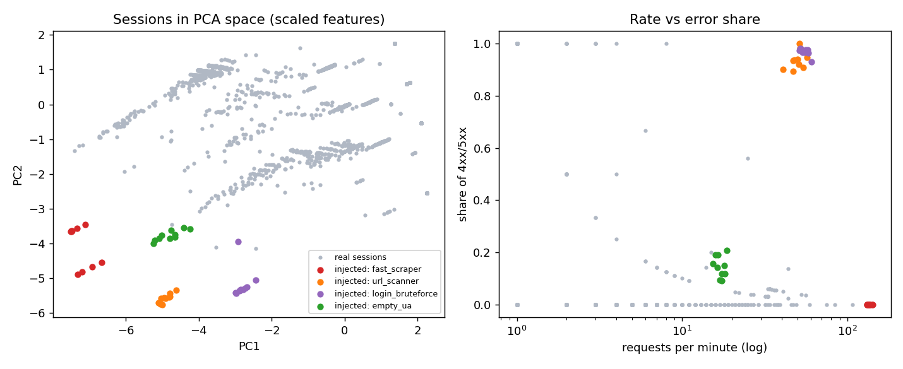

# web-bot-traffic-detection

Detecting bot traffic in web server access logs with session features, clustering (k-means, DBSCAN), anomaly detection (Isolation Forest) and simple blocking rules.

> **Important: the bots in this project are synthetic.** The log is real, but it has no bot/human labels. I wrote `src/inject_bots.py`, which *invents* 40 bot sessions (four behaviours, 10 each) and *mixes them into the real log*. All precision/recall numbers below are measured against those injected sessions only. See [Limits](#limits).

## Problem

Given a web access log, can we find automated clients (scrapers, vulnerability scanners, login brute-forcers, anonymous bulk fetchers) without labelled training data, and turn what we learn into rules a WAF or nginx config can enforce?

## Data

| | |
|---|---|
| **Dataset** | Sample web server `access.log`, combined log format (IP, timestamp, request, status, bytes, referrer, user agent). Traffic of a personal tech blog (semicomplete.com), 10,000 lines, 1,753 IPs, 17-20 May 2015 |
| **Link** | https://github.com/linuxacademy/content-elastic-log-samples |
| **Raw file** | https://raw.githubusercontent.com/linuxacademy/content-elastic-log-samples/master/access.log |
| **License** | Not verified (could not read the repo's license from my environment). Check it before redistributing; the file is committed here as `data/access.log` for reproducibility. |

Why this log: it has all required fields and real browsers (53% of requests are images/CSS/JS), plus real crawlers (Googlebot, feed readers), so "did it request CSS/images" is a meaningful feature.

Alternatives I looked at: Kaggle was not reachable from my environment, and to my knowledge Loghub's Apache sample is an *error* log (no IP/URL/status/UA). I also tried the 51k-line `nginx_logs` sample from `elastic/examples`, but 99% of it is package-manager traffic (apt/yum) with zero CSS/images, so it was a poor fit.

Note that the "real" traffic is not clean: **1,072 of the 3,052 real sessions (35%) have a self-declared bot-like user agent** (Googlebot, feed readers, curl...). They are *not* labelled as bots here, so the models get penalised for flagging them. I report those false positives separately.

## Method

1. **Parse** (`src/parse_logs.py`): one regex for the combined format → `ip, timestamp, method, url, status, bytes, referrer, user_agent`. 10,000/10,000 lines parsed (one line has a truncated user agent; the regex tolerates it).
2. **Inject synthetic bots** (`src/inject_bots.py`, seed 42). IPs come from the reserved ranges 203.0.113.0/24 and 198.51.100.0/24, so they cannot collide with real clients. 5,804 fake lines are merged by timestamp.

   | Bot type (10 each) | Behaviour |
   |---|---|
   | `fast_scraper` | 150-400 GETs of real page URLs, 0.1-0.8 s apart; half use a spoofed Chrome UA |
   | `url_scanner` | 40-60 probes of `/wp-login.php`, `/.env`, `/admin/`..., mostly 404 |
   | `login_bruteforce` | 80-300 `POST /login`, ~1 s apart, 97% 401 |
   | `empty_ua` | 30-120 page GETs with UA `-` or empty, 1-6 s apart |

3. **Sessions** (`src/features.py`): per IP, new session after a gap > 30 min → 3,092 sessions (40 injected, 1.3%).
4. **Features per session**: requests/min (duration floored at 1 min), distinct URLs, share of 4xx/5xx, mean and variance of the gap between requests, browser-like user agent, requested ≥1 image, requested ≥1 CSS file. I added two extras: `n_requests` and `top_url_share` (share of the most-hit URL, helps with login hammering). Heavy-tailed features go through `log1p`, then `StandardScaler`.
5. **Models** (`src/models.py`): k-means, DBSCAN, Isolation Forest (scikit-learn 1.8).
   - k-means: k chosen by best silhouette in 2-15 (no labels) → k = 15. A cluster counts as "bot" if ≥ 50% of its sessions are injected (this is the "look at which clusters contain the bots" step, so it uses the labels).
   - DBSCAN: `min_samples=5`, eps = 90th percentile of the 5-NN distance (0.38). Evaluated two ways: noise points only, and noise + clusters that are mostly bots.
   - Isolation Forest: 300 trees, contamination 3% (an "alert budget" I fixed before looking at results; sensitivity shown below).
6. **Rules** (`src/rules.py`) written from the cluster profiles, Isolation Forest flags and a surrogate decision tree fitted on the Isolation Forest flags.
7. **Evasion simulation** (`src/evasion.py`): smarter synthetic brute-forcers, scored by the same rules and the already-fitted Isolation Forest.

Run it from the repo root: `pip install -r requirements.txt && python src/inject_bots.py && python src/run_pipeline.py`. Outputs go to `results/`; `notebooks/walkthrough.ipynb` runs the same steps with outputs.

## Results

Evaluation unit: session. Positives = the 40 injected bot sessions. "FP" = any real session flagged.

| Method | Flagged | TP | FP | Precision | Recall | FP with bot-like UA | Other FP |
|---|---:|---:|---:|---:|---:|---:|---:|
| k-means (k=15), bot clusters | 42 | 40 | 2 | 0.95 | 1.00 | 2 | 0 |
| DBSCAN, noise points only | 243 | 16 | 227 | 0.07 | 0.40 | 68 | 159 |
| DBSCAN, noise + bot clusters | 267 | 40 | 227 | 0.15 | 1.00 | 68 | 159 |
| Isolation Forest (3%) | 93 | 40 | 53 | 0.43 | 1.00 | 3 | 50 |
| Isolation Forest (1%) | 31 | 30 | 1 | 0.97 | 0.75 | 0 | 1 |
| Rules R1-R3, dev bots (seed 42) | 41 | 40 | 1 | 0.98 | 1.00 | 1 | 0 |
| Rules R1-R3, new bots (seed 7) | 41 | 40 | 1 | 0.98 | 1.00 | 1 | 0 |



What the models showed:

- **k-means works only if k is large enough.** With k = 4 or 8 the bots are absorbed into big clusters and nothing is flagged; k = 12 finds half; k = 15 isolates them in two nearly pure clusters (all 10 brute-forcers in one; 30 scrapers/scanners/empty-UA bots in another). Silhouette was still rising at k = 15, the edge of the range I searched.
- **DBSCAN noise is a poor bot detector here.** Ten near-identical bots *form a dense cluster*, so they are not noise (recall 0.40 for noise only). DBSCAN does isolate them as pure clusters, but the noise bucket is full of unusual-but-real sessions (243 flagged).
- **Isolation Forest ranks very well but its threshold is costly.** Threshold-free average precision is 0.965, yet at a 3% alert budget it flags 93 sessions. Of its 53 false positives, 35 are real browsers loading a page with many assets in one second, 3 have bot-like UAs, 15 are other. The 1% budget gets 0.97 precision but misses all 10 `empty_ua` bots.
- **Request rate alone is not a rule.** A real browser fetching 100 assets in a second looks as fast as a scraper. The separating signal is rate *combined with* no CSS/images, or error share.

Recall by bot type: k-means (k=15), Isolation Forest (3%) and the rules caught all four types. DBSCAN noise points caught only some (scraper 0.40, brute-force 0.20, scanner 0.00, empty-UA 1.00); see `results/recall_by_bot_type.csv`.

### Blocking rules

| Rule | Condition (per session/IP) | Caught (dev / new seed) | FP |
|---|---|---|---|
| **R1** fast, no assets | ≥ 30 req/min AND ≥ 30 requests AND no CSS AND no image | 30 / 30 | 1 (msnbot, a legitimate crawler) |
| **R2** error storm | ≥ 15 requests AND ≥ 80% of responses 4xx/5xx | 20 / 20 | 0 |
| **R3** anonymous bulk | empty or `-` user agent AND ≥ 20 requests AND no CSS AND no image | 12 / 12 | 0 |

Why these thresholds: of the real sessions, only 8 have ≥ 20 requests and no CSS/images (mostly declared crawlers), and none has ≥ 15 requests with ≥ 80% errors. Allow-list verified crawlers (reverse-DNS check for Googlebot/Bingbot) before enforcing R1. In production, evaluate R1-R3 on a sliding window per IP so the block fires at the 15th-30th request, not at session end.

**Honest caveat on the "new seed" row:** seed 7 uses the same generator I wrote, so it only shows the rules are not tuned to one random draw. It says nothing about real attackers.

### Incident-style summary of the worst bot session found

**Synthetic incident (injected): credential-stuffing burst against `/login`**

- **Source:** 203.0.113.242 (documentation range), UA `python-requests/2.2.1`
- **Window:** 2015-05-19 09:50:31-09:55:47 UTC (316 s)
- **Volume:** 279 `POST /login`, about 53/min, 97% answered 401, 8 answered 302 (success)
- **Footprint:** one URL, no CSS/images, no referrer
- **Detection:** Isolation Forest rank 10 of 3,092; in k-means bot cluster; rules R1 and R2
- **Time to trigger:** R2 fires at request 15 (16 s in), so 14 guesses get through before blocking
- **Impact if unblocked:** 8 guesses got a non-401 answer; treat those accounts as compromised candidates
- **Response:** block the IP at the edge, force password reset for accounts that returned 302 to this IP, add per-account failed-login throttling

## Evasion analysis

A smarter attacker knows (or probes for) the detection logic and adapts. I simulated 20 synthetic brute-forcers per level (10,000 guesses wanted) and scored them with the rules above and the Isolation Forest fitted earlier:

| Evasion level | Rules catch | IForest catch | Guesses/hour/IP | Days for 10k guesses on 1 IP | IPs for 10k in 24 h |
|---|---:|---:|---:|---:|---:|
| E0 baseline (1 s, python UA) | 20/20 | 20/20 | 3,474 | 0.1 | 1 |
| E1 + browser UA, fetch CSS/img | 20/20 | 20/20 | 3,335 | 0.1 | 1 |
| E2 + jittered delays, mean 5 s | 20/20 | 20/20 | 714 | 0.6 | 1 |
| E3 + mean 30 s | 20/20 | 20/20 | 120 | 3.5 | 4 |
| E4 + 3 benign page GETs per guess | **0/20** | 20/20 | 112 | 3.7 | 4 |
| E5 bursts of 10 guesses, sleep 31 min | **0/20** | 20/20 | 25 | 16.4 | 17 |
| E6 bursts of 6 guesses with 2 benign GETs each, sleep 31 min | **0/20** | 20/20 | 15 | 28.1 | 29 |

How a smarter bot slips past and what it costs:

- **Faking a browser** (browser UA, fetching one CSS and one image) defeats R1, R3 and the `ua_browser`/asset features for almost no cost. This is why those features are weak on their own.
- **Slowing down and adding random delays** defeats pure rate rules (R1) and the gap-variance feature, but my error-share rule R2 does not care about speed, so E2/E3 are still caught. The price is throughput: 3,474 → 120 guesses/hour/IP, i.e. 30× slower, or 4 IPs to finish in a day.
- **Diluting errors with benign requests** (E4) beats R2 at the cost of 4× more requests per guess.
- **Splitting sessions** (E5/E6: stay under 15 requests, then sleep > 30 min) beats every session-level rule, because the session timer resets. The attacker pays with a 200× throughput drop versus baseline (15 guesses/hour/IP): one IP needs about four weeks for 10,000 guesses, or they must rent ~30 IPs, and any single guess still fails 97% of the time.
- **Isolation Forest caught all levels** here, but I would not read that as robustness: this blog is very quiet, so any 20-request burst is unusual, and the 3% alert budget that produces this also produces 53 false positives on real traffic.

Defender responses that raise the cost further: aggregate per IP (and /24) over a rolling 24 h window instead of per 30-minute session, throttle failed logins per *account* rather than per IP, add proof-of-work/CAPTCHA after a few failures, and fingerprint TLS/HTTP behaviour instead of trusting the user agent.

## Limits

- **Synthetic bots are easy and circular.** I wrote both the bot generator and the rules, and the bots are far from real traffic (e.g. 97% 401 on one URL). Scores near 1.0 overstate real-world performance. Real attackers sit much closer to normal behaviour.
- **The "real" log contains unlabelled real bots** (35% of sessions have a bot-like UA), so precision is a lower bound on what a blocklist would achieve, and some "false positives" are arguably correct.
- **Cluster selection uses labels** (a cluster is "bot" if ≥ 50% injected). In practice an analyst would read cluster profiles instead; the profiles here (no assets, high rate or errors) make that easy.
- k-means k and DBSCAN eps are heuristic; k = 15 is at the edge of my search range. Isolation Forest results depend heavily on the contamination setting.
- Models are fit and scored on the same data (transductive, no time split). Features use complete sessions, not an online sliding window.
- One small site, 3.5 days, 1-second timestamps. Thresholds will not transfer to a busier site. IP-based sessions break down behind NAT/proxies and for bots rotating IPs.
- Dataset license not verified.

## Next steps

- Get genuinely labelled traffic (honeypot, WAF logs, or a CAPTCHA-verified subset) and re-evaluate.
- Use harder synthetic bots (browser-like timing, mixed content) and generate them independently from the rules.
- Compute features on sliding windows, aggregate by IP/subnet over 24 h, add account-level signals for `/login`.
- Add time-ordered train/test splits, other detectors (LOF, one-class SVM, autoencoder), and a cost-based alert budget instead of a fixed 3%.
- Verify known crawlers by reverse DNS so they are allow-listed instead of counted as false positives.

## Repo layout

```
data/        access.log (real), access_with_bots.log + injected_labels.csv (synthetic bots added)
src/         parse_logs.py, inject_bots.py, features.py, models.py, rules.py, evasion.py, run_pipeline.py
notebooks/   walkthrough.ipynb (executed)
results/     result tables, figure, incident summary, session features
```
